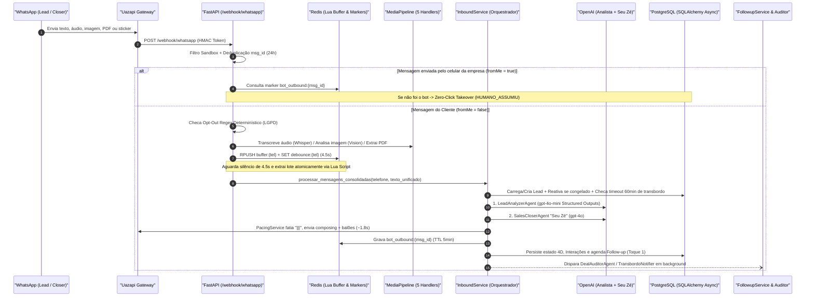
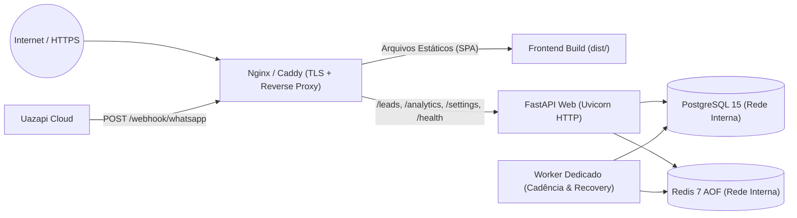

# Ecossistema Autônomo de Vendas (Inteligentte Lab) — Contexto do Projeto & Diretrizes de Produção

> **Status do Documento:** Fonte Única da Verdade (*Single Source of Truth — SSOT*)  
> **Última Auditoria Completa:** Outubro/2026  
> **Integridade Estrutural Atual:** Auditoria Backend (`10/10` camadas aprovadas, `24` rotas OpenAPI) | Frontend TypeScript (`0` erros) | Frontend Oxlint (`0` erros / `0` avisos)

---

## Sumário Executivo

Este documento consolida todo o contexto funcional, arquitetural e operacional do **Ecossistema Autônomo de Vendas da Inteligentte Lab**, servindo simultaneamente como:
1. **Recuperação de Memória do Projeto:** reconstrução exata do domínio de negócio, das decisões arquiteturais (incluindo *pivots* em relação ao PRD original) e do trabalho em andamento não commitado no repositório.
2. **Diagnóstico Pré-Produção:** mapeamento rigoroso, linha a linha, dos bloqueadores de segurança, divergências de contrato Frontend ↔ Backend e riscos de concorrência identificados na auditoria do código-fonte.
3. **Manual de Produção e Fluxo de Trabalho:** diretrizes práticas para *Go-Live* seguro e padrões de engenharia para manter velocidade e previsibilidade nas próximas entregas.

---

## 1. Contexto de Negócio & Domínio Comercial

### 1.1. A Empresa e a Tese do Produto
A **Inteligentte Lab** (`inteligentte.com.br`, sediada em João Pessoa/PB, contatos `(83) 3031-1575` e `(83) 9192-3098`) é uma consultoria e *software house* especializada em Automação Comercial e Agentes de Inteligência Artificial B2B. O **Ecossistema de Vendas** aplica *dogfooding*: a própria operação comercial da Inteligentte é conduzida por um departamento autônomo em que a IA atua na linha de frente via WhatsApp e os closers humanos intervêm cirurgicamente nos fechamentos e contas VIP.

### 1.2. Portfólio B2B Comercializado pela IA
Definido na base de conhecimento do agente ([backend/agents/prompts/closer_vendedor.py](backend/agents/prompts/closer_vendedor.py)) e nas configurações operacionais padrão ([backend/repositories/settings_repository.py](backend/repositories/settings_repository.py)):

| ID Interno | Solução | Escopo Comercial | Ticket Base Sugerido |
| :--- | :--- | :--- | :--- |
| `agente_whatsapp` | **Agentes Autônomos de IA** | SDRs e Closers 24/7 no WhatsApp com compreensão nativa de áudio, imagem e PDF para qualificação, contorno de objeções e agendamento/fechamento. | `R$ 3.500/mês` + `R$ 1.500` setup |
| `chat_inteligentte` | **Chat Inteligentte** | Plataforma multicanal centralizada (WhatsApp, Instagram, Messenger) para equipes de atendimento com CRM Kanban integrado. | `R$ 1.800/mês` + `R$ 800` setup |
| `demand_ai` | **Demand AI / Sob Medida** | Automação avançada de processos (n8n/Make) e prospecção/sistemas internos de IA sob medida integrados ao ERP/CRM do cliente. | `R$ 4.200/mês` + `R$ 2.000` setup |

- **Perfil de Cliente Ideal (ICP):** Empresas B2B/B2C com operação comercial ativa (clínicas médicas/odontológicas, imobiliárias, escritórios jurídicos/contábeis, distribuidoras, *infoprodutores* e varejo de médio/grande porte) que perdem vendas por demora no atendimento ou falta de *follow-up*.
- **Regra de Negócio VIP:** Negociações com `valor_estimado >= R$ 10.000,00` (`TRANSBORDO_VIP_VALOR_MIN`) acionam transbordo prioritário para um executivo humano.

### 1.3. A Persona "Seu Zé" e a Engenharia Conversacional
O agente de linha de frente ([backend/agents/sales_closer_agent.py](backend/agents/sales_closer_agent.py)) opera sob a identidade **"Seu Zé"**, desenhada para eliminar qualquer percepção robótica no WhatsApp brasileiro:
- **Postura Consultiva Horizontal:** Trata o empresário de igual para igual, ancorando o preço no **Custo da Inação** (quanto o cliente perde por mês ao demorar horas para responder leads pagos).
- **Anti-Formulário:** Proibição estrita de listas numeradas, menus de chatbot (`Digite 1...`), asteriscos excessivos ou múltiplas perguntas na mesma resposta.
- **Economia de Emojis:** Uso cirúrgico em no máximo ~25% das interações.
- **Cadência Multi-Balão (`|||`)**: As respostas são geradas com o delimitador `|||` (2 a 4 balões curtos). O [PacingService](backend/services/pacing/pacing_service.py) envia cada bloco separadamente após sinalizar `composing` ("digitando...") na Uazapi e aguardar ~1,8s entre balões.

---

## 2. Fotografia do Estado Atual & Recuperação do Contexto Perdido

### 2.1. Evolução do PRD vs. Implementação Real
O projeto partiu do PRD consolidado em [Contexto/prd_joined.txt](Contexto/prd_joined.txt) e sofreu refinamentos arquiteturais importantes documentados em [ARCHITECTURE.md](ARCHITECTURE.md) e no histórico Git:

| Marco do PRD | Escopo Original | Status Real | Pivots e Observações Técnicas |
| :--- | :--- | :--- | :--- |
| **Marco 1** | Fundação Backend, Banco e WhatsApp (Uazapi) | **Concluído (Expandido)** | Em vez de LangGraph + Vector DB (diagrama inicial em `Contexto/`), adotou-se **Clean Architecture em Python assíncrono** + **OpenAI Structured Outputs** + **FSM 4D** (`EtapaFunil`, `DesfechoLead`, `ControleAtendimento`, `TemperaturaLead`), buffer atômico via **Redis Lua** (`4.5s`) e pipeline multimodal de 5 mídias. |
| **Marco 2** | Fechamento, Coleta de Dados e Contrato via n8n | **Pivotado (`ee81e3d`) / Parcial** | **Pivot de Fechamento:** Ao atingir `FECHAMENTO` e coletar dados cadastrais, o sistema **não dispara mais contrato automático via n8n**; "Seu Zé" dá boas-vindas calorosas e aciona transbordo humano assistido (`PRONTO_FECHAMENTO` + `AGUARDANDO_CONTRATO`) via [TransbordoNotifier](backend/integrations/transbordo_notifier.py), somado ao **Zero-Click Takeover** e **auto-retomada em 60 min**. *Pendente do PRD:* webhooks de ingestão de anúncios/LP e disparo automático *Outbound* inicial (RF01). |
| **Marco 3** | Dashboard Gerencial, BI e Auditoria | **Em Refinamento (WIP)** | Backend BI CQRS (`/analytics/*` com 5 blocos) e [DealAuditorAgent](backend/agents/deal_auditor_agent.py) (`dossie_comercial` JSONB) concluídos. Frontend React 19 implementado e em fase de revisão visual/funcional. *Pendente do PRD:* contabilidade real de tokens/custos OpenAI no banco e trava diária de orçamento em dólares/reais (RF16 / RNF06). |
| **Marco 4** | Multicanalidade e Cadência de Follow-up | **Antecipado (WhatsApp)** | O motor de cadência de **3 toques (`2h`, `24h`, `72h`)** com respeito ao expediente comercial de Brasília e *jitter* anti-ban já está implementado em [FollowupService](backend/services/cadence/followup_service.py). Canais de E-mail (Fase 2) e Telefonia por Voz (Fase 3) seguem no *roadmap* futuro. |

### 2.2. O Que Estava Sendo Feito Antes da Perda de Histórico (Working Tree Atual)
O último commit registrado no Git é `4939b31` (*"feat(frontend): implementa painel business brutalista com visao geral, dossies de leads e diretrizes operacionais"*). Sobre esse commit, existem **alterações locais não commitadas** exclusivamente na camada visual e de documentação de UI:

1. **Refatoração Modular do Frontend (`14` arquivos rastreados alterados/deletados + `8` novos arquivos em `frontend/`):**
   - `LeadsView.tsx` foi desmembrada em componentes especializados: [LeadsFilterBar.tsx](frontend/src/components/leads/LeadsFilterBar.tsx), [LeadsListColumn.tsx](frontend/src/components/leads/LeadsListColumn.tsx), [LeadDossier.tsx](frontend/src/components/leads/LeadDossier.tsx), [BriefingModal.tsx](frontend/src/components/modals/BriefingModal.tsx) e [TransbordoModal.tsx](frontend/src/components/modals/TransbordoModal.tsx).
   - `OverviewView.tsx` foi conectada ao endpoint real `GET /analytics/overview` (tipado em [analytics.ts](frontend/src/types/analytics.ts)), removendo *fallbacks* de dados fictícios e adicionando `manualChunks` em [vite.config.ts](frontend/vite.config.ts).
   - Substituição de `GrainOverlay.tsx`, `MetricCard.tsx` e `App.css` pelo fundo procedural em Canvas 2D [GrainyGradient.tsx](frontend/src/components/GrainyGradient.tsx) e folha global [index.css](frontend/src/index.css).
2. **Matriz de Auditoria de Produto ([matriz_decisao_dashboard.csv](matriz_decisao_dashboard.csv)):**
   - Planilha recém-criada na raiz com **51 elementos de interface** mapeados nas 3 abas (`Visão Geral`, `Dossiês dos Leads` e `Configurações`), com colunas `Decisao_Manter_Ajustar_Remover` e `Observacoes` em branco aguardando validação executiva do que permanece ou sai do painel.
3. **Transição de Design System em Aberto ([.agents/rules/frontend-design.md](.agents/rules/frontend-design.md)):**
   - Foi criada uma regra estética oficial definindo a direção **"Industrial Precision & Executive Authority"** (fundo Obsidiana `#07080C` em vez de `#000000` puro; fontes `Plus Jakarta Sans` + `Inter` + `JetBrains Mono`; dualidade estrita Azul `#0052FF` para IA vs. Vermelho `#FF1E46` para Humano; proibição de *glow* neon/arcade).
   - **Importante:** O código atual em [frontend/index.html](frontend/index.html) e [frontend/src/index.css](frontend/src/index.css) **ainda está na iteração anterior** (*Tactical Graphic Brutalism* com fontes `Syne` + `Space Grotesk`, fundo `#000000` e orbs animados em [GrainyGradient.tsx](frontend/src/components/GrainyGradient.tsx)). Essa convergência visual era o próximo passo natural da frente de UI.

---

## 3. Arquitetura Técnica & Funcionamento Fim-a-Fim

### 3.1. Fluxo Operacional Completo



### 3.2. Organização das Camadas

#### Backend (`backend/` — Python + FastAPI + SQLAlchemy 2.0 Async + Redis)
- **API / Routers (`backend/api/routers/`):** Camada HTTP enxuta (Zero SQL nos routers).
  - [webhook.py](backend/api/routers/webhook.py): recepção Uazapi, validação de segredo (`hmac.compare_digest`), *Zero-Click Takeover* e disparo da task de consolidação.
  - [leads.py](backend/api/routers/leads.py): listagem/detalhe de leads, histórico de interações, endpoints de transbordo (`/assumir`, `/devolver`, `/mensagem`), auditoria sob demanda (`POST /leads/{id}/auditar`), exclusão/reset e os 6 endpoints de BI CQRS (`/analytics/*`).
  - [settings.py](backend/api/routers/settings.py): leitura e atualização de configurações operacionais (`GET/PUT /settings/operacao`).
- **Máquina de Estados 4D ([backend/models/enums.py](backend/models/enums.py) & [backend/models/lead.py](backend/models/lead.py)):**
  - `etapa_funil`: `NOVO_CONTATO` → `QUALIFICACAO` → `NEGOCIACAO` → `FECHAMENTO`.
  - `desfecho`: `EM_ANDAMENTO`, `PRONTO_FECHAMENTO`, `AGUARDANDO_CONTRATO`, `GANHO`, `CONGELADO_CADENCIA`, `DESCARTADO_IA`, `OPT_OUT`.
  - `controle`: `IA_ATIVA`, `TRANSBORDO_SOLICITADO`, `HUMANO_ASSUMIU`, `PAUSADO`.
  - `temperatura`: `FRIO`, `MORNO`, `QUENTE`.
- **Tríade de Agentes & FinOps (`backend/agents/`):**
  - [LeadAnalyzerAgent](backend/agents/lead_analyzer_agent.py) (`gpt-4o-mini`, `temperature=0.0`): extrai intenção, temperatura, dados de qualificação, objeções, valor estimado e sinais de fechamento/transbordo via *Pydantic Structured Outputs*.
  - [SalesCloserAgent](backend/agents/sales_closer_agent.py) (`gpt-4o`, `temperature=0.45`): redige a resposta persuasiva de "Seu Zé" guiada pelo diagnóstico do Analista.
  - [DealAuditorAgent](backend/agents/deal_auditor_agent.py) (`gpt-4o-mini`, `temperature=0.1`): gera o `dossie_comercial` JSONB (nota 0–10 da IA, história do lead, o que agradou/desagradou, dica de ouro e próximo passo) apenas em transições críticas ou sob demanda no painel.
- **Cadência Anti-Ban & Horário Comercial ([backend/services/cadence/followup_service.py](backend/services/cadence/followup_service.py) & [backend/core/temporal/business_hours.py](backend/core/temporal/business_hours.py)):**
  - Worker em background (`lifespan` do FastAPI, ciclo de 60s) que dispara até 3 toques (`2h`, `24h`, `72h`) exclusivamente dentro da janela comercial de Brasília (`America/Sao_Paulo`: Seg–Sex `08:30–18:30`, Sáb `09:00–12:30`), com espaçamento randômico (`8s–20s`) entre disparos.

#### Frontend (`frontend/` — React 19 + TypeScript 6 + Vite 8/Rolldown + Recharts)
- **Estrutura SPA:** Sem `react-router-dom`; alternância via estado `activeTab` em [App.tsx](frontend/src/App.tsx) com `React.lazy()` + `Suspense` para as 3 views principais:
  1. [OverviewView.tsx](frontend/src/views/OverviewView.tsx): cockpit executivo de telemetria financeira, funil de 4 etapas, distribuição térmica, gráfico semanal Recharts e Top 5 oportunidades.
  2. [LeadsView.tsx](frontend/src/views/LeadsView.tsx): central de operação para closers com filtros táticos, lista de leads e dossiê de 4 sub-abas (Estratégia, Raio-X Financeiro, Transcrição WhatsApp e Ficha Técnica).
  3. [SettingsView.tsx](frontend/src/views/SettingsView.tsx): "Sala de Máquinas" para catálogo de produtos, debounce, gatilhos de transbordo, cadência e controles de emergência.

---

## 4. Diagnóstico de Auditoria: Bloqueadores e Bugs Pré-Produção

> [!CAUTION]
> Os itens **P0** abaixo impedem a publicação segura em ambiente de produção e devem ser corrigidos antes de expor o domínio na internet ou desativar o `SANDBOX_MODE`.

### P0 — Críticos (Segurança, Persistência e Build)

1. **Exposição da Master API Key no Bundle Público do Frontend & Ausência de Autenticação de Usuário**
   - **Onde:** [frontend/src/services/api.ts](frontend/src/services/api.ts) (`L20`), [frontend/.env](frontend/.env), [frontend/src/views/SettingsView.tsx](frontend/src/views/SettingsView.tsx) (`L983`) e artefato compilado `frontend/dist/assets/api-*.js`.
   - **Problema:** Variáveis prefixadas com `VITE_` são embutidas em texto puro no JavaScript entregue ao navegador (além do fallback hardcoded `'master-secret-key-123'`). Qualquer pessoa com acesso à URL do painel pode inspecionar o bundle e obter a `ADMIN_API_KEY` que autoriza rotas destrutivas (`DELETE /leads/{id}`, `DELETE /leads/reset/por-telefone/{tel}`, `PUT /settings/operacao`). Adicionalmente, se `ADMIN_API_KEY` ou `WEBHOOK_SECRET_TOKEN` estiverem vazios no `.env`, [backend/core/security.py](backend/core/security.py) (`L25-30`, `L53-55`) entra silenciosamente em modo dev aberto (`return True`).
   - **Diretriz de Correção:** Implementar autenticação real para o painel (login com JWT/cookie `HttpOnly` ou proxy reverso BFF que injete credenciais no servidor), remover o fallback hardcoded de `api.ts` e bloquear inicialização em produção (`ENVIRONMENT=production`) caso `ADMIN_API_KEY` ou `WEBHOOK_SECRET_TOKEN` estejam vazios.

2. **Subsistema de Configurações ("Sala de Máquinas") Desconectado do Motor em Runtime**
   - **Onde:** [backend/services/settings/settings_service.py](backend/services/settings/settings_service.py) (`L106-117`), [backend/schemas/settings.py](backend/schemas/settings.py) (`L12-71`) e [frontend/src/views/SettingsView.tsx](frontend/src/views/SettingsView.tsx) (`L177-200`).
   - **Problema (4 camadas):**
     1. `_sincronizar_runtime` tenta alterar atributos inexistentes em `core.config.settings` (`HORARIO_COMERCIAL_INICIO`, `FOLLOWUP_MAX_TENTATIVAS`, `FOLLOWUP_INTERVALO_HORAS` — os nomes reais em [config.py](backend/core/config.py) são `BUSINESS_HOURS_START`, `FOLLOWUP_INTERVAL_1_HOURS`, etc.), gerando `AttributeError` engolido por `except Exception`.
     2. Nenhum serviço operacional (`SalesCloserAgent`, `InboundService`, `FollowupService`, `BusinessHoursPolicy`) lê `SettingsService` (`config:operacao_geral`); todos continuam usando constantes estáticas do `.env` e `PROMPT_BASE_VENDEDOR`.
     3. `OperacaoSettingsSchema` usa `ConfigDict(extra="ignore")` e **descarta silenciosamente** os campos enviados pela `SettingsView`: `ia_silenciada_global` (*Kill-Switch!*), `modo_24h_inbound`, `pacing` (6 gatilhos de transbordo), `integracoes`, `intervalos_toques` e metadados comerciais dos produtos.
     4. Os modais críticos de **Kill-Switch** (`SettingsView.tsx` `L177-192`) e **Limpar Filas do Redis** (`L195-200`) não possuem endpoints dedicados no backend (o expurgo do Redis apenas exibe um *toast* simulado sem chamada HTTP).

3. **Divergência de Versão Python no Build Docker & Fragilidade da Migração Alembic Inicial**
   - **Onde:** [backend/Dockerfile](backend/Dockerfile) (`L2`), [backend/uv.lock](backend/uv.lock) (`L3`), [backend/main.py](backend/main.py) (`L25`) e [backend/alembic/versions/224624f292f1_initial_schema_consolidation.py](backend/alembic/versions/224624f292f1_initial_schema_consolidation.py).
   - **Problema:** `uv.lock` exige `requires-python = ">=3.14"`, enquanto `backend/Dockerfile` usa `python:3.12-slim` (o que quebrará `uv sync --frozen` ou builds determinísticos). No banco, a migration inicial `224624f292f1` executa `ALTER TABLE leads` assumindo que as tabelas já foram criadas previamente por `Base.metadata.create_all` no boot do FastAPI e não versiona `followups_agendados` nem `configuracoes_operacionais`.

---

### P1 — Altos (Bugs Funcionais, Concorrência e Contratos Frontend ↔ Backend)

4. **Quebras de Contrato entre Enums/Schemas do Backend e Tipos do Frontend**
   - **Filtros de Leads ([frontend/src/types/telemetry.ts](frontend/src/types/telemetry.ts) `L78-80` & [LeadsFilterBar.tsx](frontend/src/components/leads/LeadsFilterBar.tsx)):**
     - Temperatura usa `'MORNA'` no frontend, mas o backend retorna `'MORNO'` (filtrar por "Morna" sempre retorna `0` leads) e falta a opção `'FRIO'`.
     - Etapa do Funil inclui `'PROPOSTA'` (inexistente em `EtapaFunil`) e omite `'NOVO_CONTATO'`.
     - Controle omite `'TRANSBORDO_SOLICITADO'` (justamente os leads que pediram ajuda humana urgente, rotulados como `'PILOTO IA'` na coluna lateral).
   - **Transcrição de Eventos de Sistema ([LeadDossier.tsx](frontend/src/components/leads/LeadDossier.tsx) `L582-598`):** O `if/else` trata apenas `origem === 'ia'` e `origem === 'humano'`; mensagens automáticas com `origem === 'sistema'` (`[TRANSBORDO ACIONADO]`, `[AUTO-RETOMADA IA]`) caem no `else` e aparecem como balões enviados pelo próprio cliente.
   - **Campos Aninhados vs. Raiz ([LeadDossier.tsx](frontend/src/components/leads/LeadDossier.tsx) & [backend/schemas/lead.py](backend/schemas/lead.py)):** O frontend lê `lead.segmento`, `lead.porte`, `lead.empresa`, `lead.setup`, `lead.mrr` na raiz e `dossie_comercial.resumo_executivo`, enquanto o backend serializa a qualificação dentro de `lead.dados_qualificacao` (`segmento`, `tamanho_equipe`, `gargalo_principal`, `cidade`, `solucao_interesse`) e `dossie_comercial.historia_do_lead`.

5. **Distorção na Taxa de Resgate de Follow-up e Congelamento Prematuro no Toque 3**
   - **Onde:** [backend/services/inbound/orchestrator.py](backend/services/inbound/orchestrator.py) (`L65`, `L203`), [backend/services/cadence/followup_service.py](backend/services/cadence/followup_service.py) (`L51`, `L195`) e [backend/repositories/analytics_repository.py](backend/repositories/analytics_repository.py) (`L226-247`).
   - **Problema:**
     - Todo balão da IA agenda o Toque 1 (`PENDENTE`); quando o cliente responde normalmente 10 segundos depois, esse agendamento vira `CANCELADO_POR_RESPOSTA`. O `AnalyticsRepository` conta *qualquer* `CANCELADO_POR_RESPOSTA` como "lead resgatado pelo follow-up" dividido por `DISPARADO`, podendo gerar `taxa_resgate_pct > 1000%` mesmo com zero follow-ups disparados. **Correção:** considerar resgate apenas quando o lead responde *após* ao menos um toque ter status `DISPARADO`.
     - Ao enviar o Toque 3 (`followup_service.py` `L195`), o worker chama imediatamente `agendar_proximo_followup(tentativa_atual=3)`, que marca o lead como `CONGELADO_CADENCIA` **no mesmo segundo do disparo**, sem aguardar janela de resposta após o 3º toque. Além disso, se o lead congelado responder depois, `motivo_perda` antigo não é limpo em `orchestrator.py` (`L137`).

6. **Condições de Corrida e Escalabilidade no Pipeline Inbound**
   - **Onde:** [backend/services/inbound/orchestrator.py](backend/services/inbound/orchestrator.py) (`L244`), [backend/agents/deal_auditor_agent.py](backend/agents/deal_auditor_agent.py) (`L66`) e [backend/api/routers/leads.py](backend/api/routers/leads.py) (`L91`).
   - **Problema:**
     - Não há lock distribuído por lead (`lock:inbound:{telefone}`) durante a chamada à OpenAI (~3–8s): se o cliente enviar nova mensagem após o debounce anterior fechar, duas execuções concorrentes podem sobrescrever `etapa_funil` e `dados_qualificacao`.
     - `disparar_auditoria_background` é acionado na `L244` **antes** do `await self.db.commit()` (`L255`), fazendo o `DealAuditorAgent` abrir nova sessão e ler dados desatualizados.
     - `DealAuditorAgent` envia todo o histórico do lead sem limite de mensagens/tokens, e `GET /leads/` carrega toda a tabela sem paginação (`limit`/`offset`).

7. **Falsos Positivos de Erro, Dados Fictícios e Lacunas Operacionais na UI**
   - **Erros mascarados como sucesso:** Em [LeadsView.tsx](frontend/src/views/LeadsView.tsx), os blocos `catch` de `handleRunAudit` (`L179-180`) e `handleConfirmTransbordo` (`L204-209`) exibem banner de sucesso ou mudam o status localmente mesmo quando o backend falha!
   - **Valores financeiros inventados no Briefing:** [BriefingModal.tsx](frontend/src/components/modals/BriefingModal.tsx) (`L47-51`) usa `valor_estimado || 25000`, `setup || 3500` e `mrr || 1800`, exportando valores fictícios para leads ainda não orçados.
   - **Filtro temporal inoperante e cálculo de funil:** Em [OverviewView.tsx](frontend/src/views/OverviewView.tsx), os botões `24H / 7D / 30D` (`L637-648`) alteram `timeRange`, mas `getTractionData()` (`L173-175`) ignora `timeRange`.
   - **Chat de transbordo somente-leitura:** [LeadDossier.tsx](frontend/src/components/leads/LeadDossier.tsx) (`L512-675`) não possui caixa de envio de mensagem humana, embora `enviarMensagemHumana` já exista em [api.ts](frontend/src/services/api.ts) (`L125`) e no backend (`POST /leads/{id}/transbordo/mensagem`).
   - **Rótulos hardcoded de terceiros:** [Header.tsx](frontend/src/components/Header.tsx) (`L111`), [LeadDossier.tsx](frontend/src/components/leads/LeadDossier.tsx) (`L543`) e [SettingsView.tsx](frontend/src/views/SettingsView.tsx) (`L870-930`) exibem `EVOLUTION API`, links fixos `app.kommo.com` com ID interno do Postgres e latências estáticas fictícias em vez de consultar `GET /health` e refletir a **Uazapi**.

---

### P2 — Médios (Design System, CSS & Responsividade)

8. **Variáveis CSS Órfãs, Falta de Responsividade e Convergência Estética**
   - **Tokens CSS ausentes em [frontend/src/index.css](frontend/src/index.css):** `var(--red-solid)` é referenciado ~20 vezes em `LeadsListColumn.tsx`, `TransbordoModal.tsx`, `LeadDossier.tsx` e `SettingsView.tsx`, mas não foi declarado em `:root` (apenas `--red-signal` e `--red-hazard` existem). As classes `btn-brutalist-red`, `btn-brutalist-blue` e `@keyframes pulse` também não existem em `index.css`.
   - **Zero `@media` queries:** `index.css` não possui breakpoints responsivos nem `@media print` para o `BriefingModal`; colunas fixas (`430px 1fr`) quebram em notebooks menores/tablets.
   - **Favicon 404:** [frontend/index.html](frontend/index.html) (`L5`) aponta para `/vite.svg` (o arquivo existente em `public/` é `favicon.svg`).

---

## 5. Diretrizes de Produção (Checklist de Go-Live & Infraestrutura)

### 5.1. Topologia de Deploy Recomendada



### 5.2. Blindagem de Segurança & Variáveis de Ambiente (`.env` de Produção)

> [!WARNING]
> Nunca suba para produção com `SANDBOX_MODE=true` (que bloqueia todos os leads exceto o número final `91923098`) nem com segredos em branco.

| Variável | Valor em Dev (`.env.example`) | Diretriz Obrigatória para Produção |
| :--- | :--- | :--- |
| `ENVIRONMENT` | `development` | `production` (desabilitar `/docs` e `/redoc` públicos no `FastAPI(...)`). |
| `SANDBOX_MODE` | `true` | `false` após validação final ponta a ponta com número real. |
| `ADMIN_API_KEY` | *(vazio ou `master-secret-key-123`)* | Segredo criptográfico forte (`>= 32` bytes via `openssl rand -hex 32`), **nunca exposto em `VITE_*`**. |
| `WEBHOOK_SECRET_TOKEN` | *(vazio)* | Token exclusivo validado via header `X-Webhook-Token` / `Authorization` na Uazapi. |
| `CORS_ORIGINS` | `*` | Domínio exato do painel (ex.: `https://vendas.inteligentte.com.br`). |
| `DATABASE_URL` | `postgresql+asyncpg://postgres:postgres@db:5432/...` | Usuário dedicado com senha forte; **remover** `ports: ["5432:5432"]` do `docker-compose` de produção. |
| `REDIS_URL` | `redis://redis:6379/0` | Habilitar `--requirepass` + `--appendonly yes` (AOF) e **remover** `ports: ["6379:6379"]` do host público. |
| `SUPERVISOR_PHONE` | *(vazio)* | WhatsApp E.164 do gestor comercial (ex.: `5583991923098`) para receber alertas imediatos de fechamento/VIP. |

### 5.3. Containers, Concorrência e Banco de Dados
1. **Docker de Produção (`docker-compose.prod.yml`):**
   - Alinhar a imagem Python do [backend/Dockerfile](backend/Dockerfile) com o `pyproject.toml`/`uv.lock` (ex.: padronizar em Python `3.12` ou `3.13/3.14` oficial com `uv sync --frozen --no-dev`) e **remover o bind-mount `./backend:/app`** em produção (código imutável copiado na imagem com usuário não-root).
   - Criar `frontend/Dockerfile` multi-stage (`node:22-alpine` para `npm ci && npm run build` → `nginx:alpine` servindo `/usr/share/nginx/html` com `try_files $uri /index.html` e proxy reverso para o backend).
2. **Isolamento do Worker de Background (Multi-Worker Safety):**
   - Atualmente, `FollowupService.worker_loop()` e `recuperar_buffers_pendentes()` rodam dentro do `lifespan` de [backend/main.py](backend/main.py). Se o Uvicorn subir com `--workers 4`, **4 loops de follow-up rodarão em paralelo**, podendo disparar mensagens duplicadas.
   - **Regra de Produção:** Manter `--workers 1` enquanto o loop estiver acoplado ao `lifespan`, **ou** extrair o `FollowupService` para um processo/container separado (`python -m workers.cadence_worker`) — ou proteger o ciclo com um *distributed leader lock* no Redis (`SET lock:followup_worker <id> NX EX 55`).
   - Substituir `redis.keys("buffer:*")` em [consolidation.py](backend/services/inbound/consolidation.py) (`L143`) por `SCAN` assíncrono (`scan_iter`), evitando bloqueio `O(N)` do Redis.
3. **Governança de Migrações (Alembic):**
   - Gerar uma migração baseline completa que crie `leads`, `interacoes`, `followups_agendados` e `configuracoes_operacionais` do zero (`CREATE TABLE IF NOT EXISTS` ou baseline condicional), desativar `Base.metadata.create_all` no startup de produção e executar `alembic upgrade head` como etapa explícita de *release*.
4. **Backups & Observabilidade:**
   - Agendar `pg_dump` diário automatizado com retenção mínima de 14 dias.
   - Conectar o indicador de saúde do painel ao endpoint real `GET /health` ([backend/main.py](backend/main.py) `L102`), monitorando conectividade com PostgreSQL e Redis via Uptime Kuma / Prometheus.
   - **FinOps & LGPD:** Persistir `usage.prompt_tokens` / `completion_tokens` retornados pela OpenAI para cumprir RF16/RNF06 (alerta/teto diário de custo) e mascarar CPF/CNPJ/dados sensíveis em logs de texto plano.

---

## 6. Diretrizes de Fluxo de Trabalho (Engenharia & Colaboração)

Para evitar regressões, retrabalho visual ou perda de contexto entre sessões, todo ciclo de desenvolvimento neste projeto deve seguir estas **5 regras operacionais**:

### 6.1. Contrato *Backend-First* (Sincronia Obrigatória de Tipos)
Nenhuma alteração em [backend/models/enums.py](backend/models/enums.py), [backend/schemas/lead.py](backend/schemas/lead.py), [backend/schemas/auditor.py](backend/schemas/auditor.py) ou [backend/schemas/settings.py](backend/schemas/settings.py) é considerada pronta sem atualizar no mesmo commit:
- [frontend/src/types/telemetry.ts](frontend/src/types/telemetry.ts)
- [frontend/src/types/analytics.ts](frontend/src/types/analytics.ts)
- [frontend/src/types/settings.ts](frontend/src/types/settings.ts)

### 6.2. Respeito à Arquitetura em Camadas e Governança Visual
- **Backend:** Routers (`api/routers/`) **nunca** importam `AsyncSession` para executar queries diretas; toda regra de negócio vive em `services/` e toda query SQLAlchemy vive em `repositories/`. Prompts ficam isolados em `agents/prompts/` e schemas LLM em `schemas/`.
- **Frontend:** Antes de criar ou estilizar componentes, consultar obrigatoriamente [.agents/rules/frontend-design.md](.agents/rules/frontend-design.md) e registrar decisões de escopo na [matriz_decisao_dashboard.csv](matriz_decisao_dashboard.csv).

### 6.3. Portão de Qualidade Local (Quality Gate no Windows PowerShell)
Antes de qualquer commit ou deploy, os **4 comandos abaixo** devem passar com **100% de sucesso**:

```powershell
# 1. Auditoria estrutural completa do Backend (UTF-8 obrigatório no PowerShell do Windows)
$env:PYTHONIOENCODING="utf-8"; python backend/tests/scripts/auditoria_geral_do_projeto.py

# 2. Suíte automatizada de testes do Backend (Pytest Async)
$env:PYTHONIOENCODING="utf-8"; pytest backend/tests -q

# 3. Verificação estrita de tipos TypeScript no Frontend
cd frontend; npx tsc -b --noEmit; cd ..

# 4. Linter rápido Oxlint no Frontend (zero warnings / zero errors)
cd frontend; npx oxlint; cd ..
```

### 6.4. Higiene de Git e Commits Atômicos Semânticos
- Evitar acumular dezenas de arquivos modificados sem *checkpoint*. Sempre separar refatorações estruturais, mudanças estéticas e correções de contrato em commits pequenos no padrão **Conventional Commits** em português:
  - `feat(escopo): ...` | `fix(escopo): ...` | `refactor(escopo): ...` | `docs(escopo): ...` | `chore(infra): ...`
- Manter este arquivo (`CONTEXTO_E_DIRETRIZES_PRODUCAO.md`) e o `ARCHITECTURE.md` atualizados sempre que houver mudança de regra de negócio ou novo endpoint/serviço.

---

## 7. Roteiro Sugerido de Próximos Passos (Plano de Ação)

Para retomar a evolução do projeto com máxima eficiência a partir de hoje, recomenda-se a seguinte ordem em **4 Sprints curtas**:

1. **Sprint 1 — Fechamento do WIP Atual & Decisão do Dashboard:**
   - Revisar e preencher a [matriz_decisao_dashboard.csv](matriz_decisao_dashboard.csv) (definir o que fica, ajusta ou sai nas 3 abas).
   - Alinhar [frontend/src/index.css](frontend/src/index.css) e [frontend/index.html](frontend/index.html) às diretrizes oficiais de [.agents/rules/frontend-design.md](.agents/rules/frontend-design.md) (corrigindo os tokens quebrados `--red-solid`, tipografia e responsividade) e consolidar o estado atual em um commit limpo.
2. **Sprint 2 — Alinhamento de Contratos Frontend ↔ Backend (P1):**
   - Sincronizar enums (`MORNO`, `FRIO`, `NOVO_CONTATO`, `TRANSBORDO_SOLICITADO`), mapear `dados_qualificacao` e `historia_do_lead`, tratar `origem === 'sistema'` na transcrição, habilitar o input de envio de mensagem humana no `LeadDossier`, remover valores fictícios do `BriefingModal` e corrigir os `catch` enganosos em `LeadsView.tsx`.
   - Conectar o `SettingsService` de ponta a ponta ao runtime (incluindo *Kill-Switch* real e endpoint real de limpeza/inspeção de buffers Redis).
3. **Sprint 3 — Estabilização Backend & Métricas BI (P1):**
   - Corrigir a fórmula de `taxa_resgate_pct` e a janela de espera pós-Toque 3 antes de `CONGELADO_CADENCIA`.
   - Adicionar lock Redis por lead (`lock:inbound:{telefone}`), mover `disparar_auditoria_background` para depois do `db.commit()`, limitar janela de histórico do `DealAuditorAgent` e paginar `GET /leads/`.
4. **Sprint 4 — Hardening de Produção & Go-Live (P0):**
   - Proteger autenticação do painel (eliminar `ADMIN_API_KEY` do bundle `VITE_*`), alinhar `Dockerfile` + migração baseline do Alembic, criar container Nginx do Frontend, isolar o worker de cadência e virar `SANDBOX_MODE=false` em produção.

---

## 8. Registro de Execução — Reestruturação Clean Architecture & Dual Prestige (v1.3.0)

Todas as frentes identificadas na auditoria arquitetural (Fases 1 a 4) foram executadas e verificadas:

- **Fase 1 (Backend Clean Architecture, SOLID & Concorrência):**
  - Extraída 100% da lógica de domínio do router `POST /webhook` para `WebhookApplicationService` (`services/inbound/webhook_service.py`) com injeção de `CacheBufferProtocol` e `session_factory`.
  - Refatorados `DashboardService` e `TransbordoService` (`services/handover/`) substituindo herança acoplada por composição explícita, eliminando queries SQLAlchemy da camada de serviço (`LeadRepository.list_pending_handover`) e injetando `WhatsAppGatewayProtocol` + `CacheBufferProtocol`.
  - Criado `core/background.py` (`spawn_background_task`, `drain_background_tasks`) garantindo referências fortes para tasks assíncronas e drenagem limpa no shutdown.
  - Centralizada detecção DRY de esgotamento de cota da OpenAI em `core/openai_client.py` (`is_openai_quota_error`) e adicionada guarda FinOps de recorte de janela em `agents/deal_auditor_agent.py`.
  - Implementado lock distribuído por telefone (`lock:inbound:{telefone}`) via Lua atômico, substituído `redis.keys()` por `SCAN` não-bloqueante, corrigido o commit pré-auditoria no `InboundService`, higienizado `motivo_perda` em retomadas, respeitada a janela de graça pós-último toque antes de `CONGELADO_CADENCIA` e corrigida a fórmula de `taxa_resgate_pct` (`0% <= taxa <= 100%`).
- **Fase 2 (Sala de Máquinas Viva & Governança):**
  - Expandido contrato `schemas/settings.py` com `PacingConfig`, `intervalos_toques`, campos estratégicos de `ProdutoItem`, `modo_24h_inbound` e `ia_silenciada_global`.
  - Sincronizado `SettingsService` com cache L1 em memória (`obter_cache_memoria`), atualização dos campos reais de `core.config.settings`, injeção dinâmica do catálogo ativo no prompt do `SalesCloserAgent` e novos endpoints `POST /settings/kill-switch` e `POST /settings/redis/purge`.
- **Fase 3 (Re-Arquitetura Frontend & Design System Canônico *Dual Prestige*):**
  - Eliminada exposição de `ADMIN_API_KEY` do bundle público (`AuthKeyModal` + `sessionStorage` + interceptação `401/403` em `src/services/api.ts`).
  - Ativado `"strict": true` em `tsconfig.app.json`, contratos 1:1 com o Backend (`MORNO`, `FRIO`, `NOVO_CONTATO`, `TRANSBORDO_SOLICITADO`, `dados_qualificacao`, `historia_do_lead`, `origem: 'sistema'`), zero valores fictícios inventados no `leadMapper.ts` e envio real de mensagens WhatsApp pelo painel no `DossierWhatsAppTab.tsx`.
  - Decompostos os antigos God Components em hooks dedicados (`src/hooks/`), views enxutas (`src/views/`) e subcomponentes coesos (`src/components/{overview,leads,settings,modals}/`) sob o Design System Obsidian (`#07080C`, `#0C0E16`, `#121522`, `#1E2336`, `#0052FF` vs. `#FF1E46`, *Dual Prestige Beam* 2px, `Plus Jakarta Sans` + `Inter` + `JetBrains Mono` `tabular-nums`).
- **Fase 4 (Infraestrutura, Alembic & Portões de Qualidade):**
  - Alinhados `backend/pyproject.toml` (Python 3.12+), `backend/Dockerfile` (usuário não-root `appuser`), `frontend/Dockerfile` + `frontend/nginx.conf` (build multi-stage + Nginx 1.27), `docker-compose.yml` (portas restritas a `127.0.0.1` + serviço `frontend`) e migração baseline idempotente do Alembic (`CREATE TABLE IF NOT EXISTS` + `CREATE INDEX IF NOT EXISTS`).


